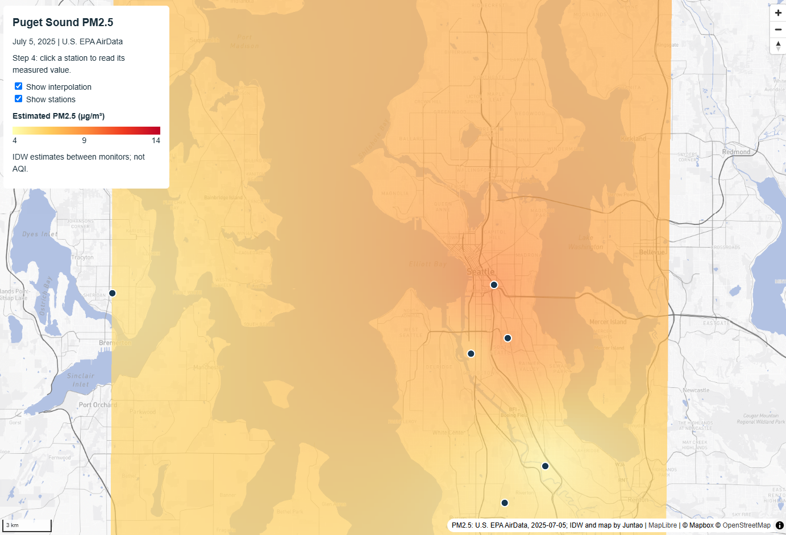
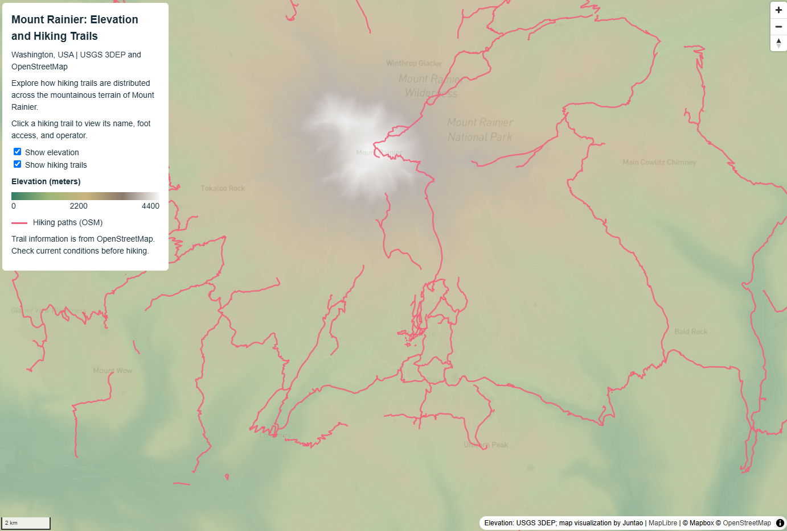

# GEOG 458 Lab 3: Map Design and Tile Generation

## 1. Project Overview

This project explores how raster tile pyramids and interactive vector data can be combined to create web maps using QGIS, Mapbox Studio, QMetaTiles, and MapLibre GL JS.

Two interactive web maps were developed:

1. **Puget Sound PM2.5:** A guided map showing interpolated PM2.5 concentrations and air-quality monitoring stations in the Puget Sound region.
2. **Mount Rainier Elevation and Hiking Trails:** An independent map showing elevation patterns and hiking paths around Mount Rainier National Park, Washington.

Each map combines a customized Mapbox Studio basemap, a separately exported thematic raster layer, and related GeoJSON vector features. The raster layers are displayed using local PNG tiles, while vector data provides additional geographic information through interactive popups.

The maps demonstrate how pre-rendered raster tiles and interactive vector features can work together in a browser without requiring live GIS processing.

## 2. Guided Map: Puget Sound PM2.5

### Purpose and Audience

The guided map visualizes the spatial distribution of estimated PM2.5 concentrations across the Puget Sound region on July 5, 2025.

It is intended for students, researchers, and members of the public interested in understanding regional air-quality patterns and the relationship between monitoring observations and interpolated estimates.

The map allows users to compare estimated PM2.5 concentrations with actual measurements recorded at monitoring stations.

### Data Sources

- **PM2.5 observations:** U.S. EPA AirData, July 5, 2025. The provided dataset contains observations from 11 monitoring sites.
- **Basemap:** A customized Mapbox Studio style, using Mapbox and OpenStreetMap geographic data.
- **Station locations:** `data/pm25_stations.geojson`.
- **Source metadata:** `data/pm25_source.json`.

PM2.5 concentrations are measured in micrograms per cubic meter (µg/m³), not Air Quality Index (AQI).

### Data Processing and Visualization

The provided PM2.5 observations were loaded into QGIS using geographic coordinates. Station points were used to create a continuous concentration surface through Inverse Distance Weighting (IDW) interpolation.

The interpolation used a 250-meter raster grid. The resulting raster was styled in QGIS using a five-color yellow-to-red gradient representing PM2.5 concentrations from 4 to 14 µg/m³.

The customized basemap and the interpolated PM2.5 surface were exported separately using QMetaTiles.

The final web map uses:

- `assets/mapbox-guided/` for the basemap.
- `assets/pm25-guided/` for the interpolated PM2.5 raster.
- `data/pm25_stations.geojson` for interactive monitoring stations.

MapLibre GL JS displays these layers together. Users can toggle the interpolation and station layers independently and click station points to view the station name, measured PM2.5 concentration, measurement date, and station ID.

### Interpretation and Limitations

The IDW surface represents estimated PM2.5 concentrations between monitoring stations. It does not represent direct measurements at every location.

The 250-meter raster resolution describes the output grid size, not the accuracy of the air-quality estimates. Uncertainty increases in areas with limited monitoring coverage.

Station points represent measured observations, while the colored raster surface represents interpolated estimates. These two forms of information should not be interpreted as equivalent.

The map is intended for educational visualization and should not be used for regulatory or health-related conclusions.

## 3. Independent Map: Mount Rainier

### Purpose and Audience

The independent map explores the relationship between elevation and hiking trail distribution around Mount Rainier National Park in Washington State.

It is designed for hikers, park visitors, geography students, and others interested in understanding how hiking routes relate to mountainous terrain.

By combining elevation data with hiking trails, users can identify high-elevation areas, observe major terrain patterns, and explore how walking paths are distributed around Mount Rainier.

The map emphasizes the geographic relationship between the physical landscape and the trail network rather than providing real-time hiking navigation.

### Data Sources

- **Elevation raster:** USGS 3D Elevation Program (3DEP), obtained through The National Map. The downloaded DEM tile was `n47w122`, saved locally as `elevation_raw.tif`.
- **Hiking trails:** OpenStreetMap data retrieved using Overpass Turbo. The query selected features classified as `highway=path` or `highway=footway` around Mount Rainier.
- **Basemap:** A customized Mapbox Light style created in Mapbox Studio using Mapbox and OpenStreetMap data.
- **Trail GeoJSON:** `data/trails_raw.geojson`.

The elevation data represents terrain height in meters, while the hiking trail data represents vector line features.

The Overpass Turbo query returned 818 OSM ways within or intersecting the study area. Individual OSM ways do not necessarily correspond to complete, independently named hiking trails.

### Data Processing and Visualization

The USGS DEM was imported into QGIS as a GeoTIFF raster.

The raster was visualized using Singleband Pseudocolor with linear interpolation and a five-color elevation ramp. Lower elevations were represented by green shades, middle elevations by tan and brown shades, and higher elevations by light gray and white.

The visualization used an elevation display range of approximately 0–4,400 meters.

A separate Mapbox Light basemap was customized in Mapbox Studio and connected to QGIS through WMTS. The light-colored basemap was selected to minimize visual competition with the elevation raster.

Both raster layers were exported independently using QMetaTiles:

- `assets/mapbox-independent/` contains the Mapbox Light basemap tiles.
- `assets/elevation/` contains the styled USGS elevation raster tiles.

Hiking trails were downloaded from OpenStreetMap through Overpass Turbo and saved as GeoJSON. The data was inspected in QGIS to confirm its spatial relationship with the elevation raster.

The original trail GeoJSON was retained for the final web map.

In MapLibre GL JS, the trail data is displayed as pink line features above the two raster layers. Users can click a trail to view the following OpenStreetMap attributes:

- **Trail Name (`name`):** The recorded name of the path, when available.
- **Foot Access (`foot`):** The recorded pedestrian access designation.
- **Operator (`operator`):** The recorded trail operator or managing organization.

Missing attribute values are displayed as "Not specified" or "Unnamed Trail."

Users can independently toggle the elevation raster and hiking trail layers. The elevation layer is displayed at 65% opacity so that the basemap remains partially visible.

### Interpretation and Limitations

The elevation raster is derived from USGS terrain data and represents geographic elevation rather than interpolated air-quality estimates.

The colors visualize elevation ranges and should not be interpreted as direct classifications of vegetation, snow cover, or land use.

The hiking trail data is obtained from OpenStreetMap and may contain incomplete names, missing attributes, or outdated information.

The `highway=path` and `highway=footway` classifications include various types of walking paths and do not guarantee that every feature represents a maintained or officially open hiking trail.

The map does not provide real-time information about trail closures, weather conditions, snow, hazards, or accessibility.

Users should consult the National Park Service and other authoritative sources before planning hikes.

This map is intended for geographic exploration and educational purposes rather than navigation or safety-critical decisions.

## 4. Tile Export Settings

### Extent, Zoom Levels, and Tile Format

Both maps use raster tile pyramids generated in QGIS through QMetaTiles.

The basemap and thematic raster for each map were exported separately to allow independent layer visibility and opacity controls in MapLibre GL JS.

| Setting | Guided Map | Independent Map |
|---|---|---|
| Study area | Puget Sound, Washington | Mount Rainier, Washington |
| Basemap tiles | `mapbox-guided` | `mapbox-independent` |
| Thematic tiles | `pm25-guided` | `elevation` |
| Zoom levels | 8–12 | 9–13 |
| Tile size | 256 × 256 pixels | 256 × 256 pixels |
| Tile format | PNG | PNG |
| Tile convention | XYZ | XYZ |
| Basemap background transparency | 0 | 0 |
| Thematic background transparency | 100 | 100 |
| Thematic display opacity in HTML | 0.70 | 0.65 |
| Project CRS for export | EPSG:3857 | EPSG:3857 |

The guided map focuses on the central Puget Sound region, approximately between longitudes -122.75 and -122.05 and latitudes 47.10 and 48.15.

The independent map focuses on Mount Rainier and nearby hiking trails. Its planned study-area bounding box is approximately:

- West: -121.98
- East: -121.52
- South: 46.68
- North: 47.02

QMetaTiles used the QGIS canvas extent during export, so the exact exported tile coverage may extend beyond these approximate geographic boundaries.

For both maps, PNG tiles are stored in the standard `{z}/{x}/{y}.png` directory structure.

The local raster tile pyramids preserve the appearance of the maps but do not retain their original numerical raster values or GIS attribute tables. Interactive attributes are instead provided by the separate GeoJSON vector datasets.

## 5. Map Screenshots

### Guided Map: Puget Sound PM2.5

### Independent Map: Mount Rainier Elevation and Hiking Trails

